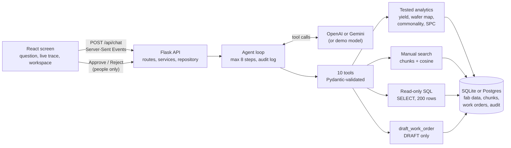

# FabCopilot

[](https://github.com/newway1814/wombat256.vim/actions/workflows/ci.yml)

An AI copilot for semiconductor yield engineers. Ask why yield dropped, and an agent
investigates a synthetic 300 mm fab: it flags the low lots, finds the chamber the bad wafers
share, reads the wafer maps and the chamber's sensor chart, cites the SOP and a past
maintenance case, and drafts a work order that only a person can approve.


*Demo mode, no API key: real tools on real (synthetic) data; only the model's decisions are scripted.*

## Quick start

```bash
docker compose up --build      # then open http://localhost:8080
```

That starts Postgres, the API and the screen. On first start the API builds the fake fab and
indexes the manuals (about 15 s). Without a key it runs in demo mode. To use a real model, put
`OPENAI_API_KEY=...` or `GEMINI_API_KEY=...` and `LLM_PROVIDER=auto` in a `.env` file next to
`docker-compose.yml`. To run without Docker, see [Run it locally](#run-it-locally).

## How it works



Three design rules carry the project:

1. **The model plans; tested code does the maths.** The LLM chooses tools and writes the
   answer. Every number comes from a unit-tested function or a SQL query, never from the model.
2. **Every claim is checkable.** The screen streams each tool call and its raw result, and
   answers cite manual sections by chunk ID, such as `[SOP-ETCH-001#1]`.
3. **The worst case is a bad suggestion, never a bad action.** SQL is read-only, the only
   write tool creates a draft, approval is a separate endpoint that only a person's click
   calls, and everything is written to the audit log.

On the fake fab the agent's evidence agrees from four directions:

| Evidence | Tool | Result |
| --- | --- | --- |
| Which chamber the bad wafers share | `find_commonality` | ETCH-03-B at gate etch: 54 of 55 bad wafers, adjusted p 1.3e-37 |
| What the wafers look like | `classify_wafer_map` | Edge ring: 84.7% of edge dies fail on L2610040-04, 7.6% inside |
| How the chamber's sensor behaved | `spc_chart`, `compare_around_pm` | Reflected RF power 10.86 → 18.27 W after the PM on 26 Oct; 7 of 7 points since are out of control |
| What the manuals say | `search_docs` | RF-match SOP, and the same fault on the same chamber in 2025 |

## Layout

```
backend/
  app/            Flask app: api/, services/, analytics/, rag/, agent/, models.py
  data/           8 synthetic SOPs and 20 maintenance logs (markdown)
  scripts/        generate_data, ingest_docs, bootstrap, ask
  tests/          pytest, offline with a fake model (+ Postgres tests)
  evals/          15 golden questions and the runner
frontend/
  src/            React + TypeScript: pages/, components/, api/, styles/
  e2e/            Playwright end-to-end tests
docs/demo.gif
docker-compose.yml, .github/workflows/  (CI on every push, evals on demand)
```

## The fake fab

`scripts/generate_data.py` builds four weeks of history for 40 lots of 25 wafers: 8 route
steps, 4 etch tools with 2 chambers each, sensor summaries for every etch run, and a pass/fail
result for every die. The same seed always gives identical data.

One problem is planted for the agent to find: after a PM on chamber **ETCH-03-B** on
2026-10-26, reflected RF power drifts up and the wafers it etches at gate etch get edge-ring
failures (mean yield about 82% against about 95% elsewhere).

## API

Routes stay thin; logic lives in `app/services/`, storage in `app/repository.py`. The agent's
tools call the same services, so the screen and the agent can't disagree. Errors are JSON:
`{"error": {"code": "not_found", "message": "Lot NOPE not found"}}`.

| Endpoint | Returns | Query |
| --- | --- | --- |
| `GET /api/health` | `{"status": "ok"}` | |
| `GET /api/lots` | lots, newest first, with mean yield | `limit` 1–200, `offset`, `status` |
| `GET /api/lots/<id>` | wafers and which chambers ran them at each step | |
| `GET /api/wafers/<id>/map` | every die's x, y and bin, plus bin counts | |
| `GET /api/chambers/<id>/fdc` | one sensor over time, plus PMs in the window | `param`, `from`, `to`, `limit` |
| `GET /api/docs/search` | top manual/log sections, each with a chunk ID | `q`, `k` 1–20 |
| `POST /api/chat` | the agent's steps as Server-Sent Events | body `{"message", "history"?}` |
| `GET /api/tickets` | work orders, newest first | |
| `POST /api/tickets/<id>/approve` | approve a DRAFT (409 if already decided) | body `{"by"}` |
| `POST /api/tickets/<id>/reject` | reject a DRAFT (409 if already decided) | body `{"by"}` |
| `GET /api/audit` | every chat, tool call and human decision, newest first | `limit` |

## Analytics

Plain, unit-tested Python in `app/analytics/`; the LLM never calculates, it calls these through
`app/services/analytics.py`.

| Module | Answers | Method |
| --- | --- | --- |
| `yield_check.py` | Which lots are unusually low? | Robust baseline (median, MAD sigma); flag below baseline - 3 sigma |
| `wafer_map.py` | What pattern is on this wafer? | Edge-band vs inner fail rate; largest touching group of failed dies |
| `commonality.py` | Which chamber do bad wafers share? | Fisher's exact test per (step, chamber), Bonferroni-adjusted |
| `spc.py` | Is this chamber out of control? | X-bar chart per lot visit, Western Electric rules 1-4; Welch t-test around a PM |

On the fake fab: commonality ranks ETCH-03-B at gate etch first (adjusted p about 1e-37), every
edge-ring wafer comes from it after its PM, and its SPC chart fires only after the PM.

## Manuals and search (RAG)

`data/sops/` holds 8 synthetic SOPs and `data/logs/` 20 past maintenance logs. They are split
at their headings into 119 chunks, embedded, and stored in the `doc_chunks` table. Search is
cosine similarity in NumPy (a few hundred vectors fit in memory; pgvector is the upgrade path),
returning the best chunk per document with its ID, e.g. `SOP-ETCH-001#3`, for citations.

- With `OPENAI_API_KEY` set, embeddings come from `text-embedding-3-small`.
- Without a key (and in tests) a deterministic word-hashing embedder with IDF weighting is
  used. It finds the right document in the top 5 for 12 of 12 golden questions, but it only
  matches words, not meaning.

## The agent

`app/agent/` runs a tool-calling loop (at most 8 steps) over 10 tools: eight analysis tools
that call the tested services, a read-only `run_sql` fallback, and `draft_work_order`.

- **Model**: OpenAI or Gemini, whichever key is in `.env` (`LLM_PROVIDER` to force one). Both
  sit behind one small interface, so tests use a scripted fake model and never call an API.
- **Arguments** are validated with Pydantic; the same models produce the JSON schemas the
  model sees. Bad arguments come back to the model as a readable error, not a crash.
- **`run_sql`** accepts one SELECT, refuses write keywords, runs read-only at the database
  level too (`PRAGMA query_only` on SQLite; a read-only transaction with a 5 s timeout on
  Postgres), and returns at most 200 rows.
- **Work orders** are drafts. Approving or rejecting is a separate endpoint only a human
  click calls; the agent has no tool for it. Deciding twice returns 409.
- **Audit log**: every question, tool call (arguments, ok, duration) and decision.

Try it from the terminal once a key is set: `python -m scripts.ask`.

**Demo mode** (`LLM_PROVIDER=demo`, no key needed) swaps the model for a scripted stand-in that
runs the real tools on the real data in the reference order and writes its answer only from
their results. It always runs that same investigation, whatever you ask; use it to demo the
screen, and a real key to ask anything else.

## The screen

`frontend/` is React + TypeScript (Vite), styled by hand from design tokens in
`src/styles/tokens.css` (light and dark), with IBM Plex Sans and Mono bundled locally.

- **Investigate**: a single question box. Press Enter and the conversation moves left while a
  workspace opens on the right. Every tool result appears there as it arrives over Server-Sent
  Events: flagged lots, commonality, the lot, the wafer map, the SPC chart, the before/after
  PM test, chamber events, sources, and the draft work order with Approve and Reject. The trace
  on the left shows each call running, then done; click a line for its raw result. Clicking a
  lot or wafer opens it in the workspace.
- **Lots**, **Work orders**, **Audit log**: plain pages over the same API.
- Charts are hand-drawn SVG (no chart library), so they follow the design exactly.

## Tests and evals

| What | Where | Runs |
| --- | --- | --- |
| Backend unit and API tests (93), offline with a fake model | `backend/tests` | every push |
| Same findings, SQL guard and tickets on real PostgreSQL | `tests/test_postgres.py` | every push (CI Postgres service) |
| Frontend unit tests: stream parser, formatting | `frontend/src/*.test.ts` | every push |
| End to end in Chromium: ask, watch it stream, open a lot, approve, audit | `frontend/e2e` | every push |
| Whole stack from a clean machine: `docker compose up`, smoke test through nginx | CI `docker` job | every push |
| 15 golden questions against a real model | `backend/evals` | on demand (costs API credits) |

**Evals.** `python -m evals.run_evals` runs each golden question on a fresh fake fab and checks
the tools called, the answer's facts and citations, whether it drafted a work order, and two
invariants (all 40 lots still exist; no work order decided without a human). Results so far:

| Model | Pass rate | Notes |
| --- | --- | --- |
| `demo/scripted` | 2 / 15 (13%) | Expected: it runs the same investigation for every question, so it drafts work orders when it shouldn't and answers the wrong question. It proves the evals catch that. Invariants held in all 15. |
| A real model (OpenAI or Gemini) | not run yet | Needs a key: `python -m evals.run_evals`, or the Evals workflow on GitHub. |

## Run it locally

Needs Python 3.11+ and Node 20+.

```bash
# Backend (terminal 1)
cd backend
python -m venv .venv
source .venv/bin/activate          # Windows: .venv\Scripts\activate
pip install -r requirements-dev.txt
cp .env.example .env               # add an OpenAI or Gemini key; .env is never committed
pytest                             # all tests pass (Postgres tests skip without TEST_POSTGRES_URL)
python -m scripts.bootstrap        # builds fabcopilot.db and indexes the manuals (about 3 s)
python wsgi.py                     # API on :5000
#   no key? LLM_PROVIDER=demo python wsgi.py

# Frontend (terminal 2)
cd frontend
npm install
npm run dev                        # http://localhost:5173
npm test && npm run e2e            # unit tests; end-to-end (PYTHON=../backend/.venv/bin/python)
```

## Limitations

Honest about what this is and isn't:

- **Synthetic data with one planted cause.** One product, 8 route steps, 40 lots over four
  weeks. Real MES and FDC data are larger, messier and confidential.
- **A real model hasn't been scored yet.** The evals and the live tests need an API key. The
  demo model is scripted: it runs the same investigation whatever you ask.
- **Offline search matches words, not meaning.** For "edge ring reflected power" it ranks the
  RF-match SOP 4th, behind three logs that share the words. Real embeddings are the fix; a live
  test holds them to the top 3.
- **Analytics are deliberately simple.** Wafer-map labels are rules, not a trained classifier.
  Commonality tests each step on its own, so lot routing can make an innocent tool look
  suspicious (implanter IMP-02-A does, with adjusted p 3.7e-11). The agent is told to confirm
  with other evidence for this reason.
- **No login.** "Decide as" is a typed name, so the audit log trusts it. A real deployment
  would use the fab's single sign-on.
- **Conversations aren't saved.** A refresh starts over, and only the last 10 messages go back
  to the model.

## What I'd build next

1. **Real data adapters**: the same tool interfaces over MES and FDC APIs.
2. **An MCP server** exposing the tools, so other teams' agents can reuse them.
3. **A wafer-map classifier** trained on the public WM-811K dataset (about 811k real maps).
4. **Hybrid search** (keyword + vector) for error codes and tool IDs.
